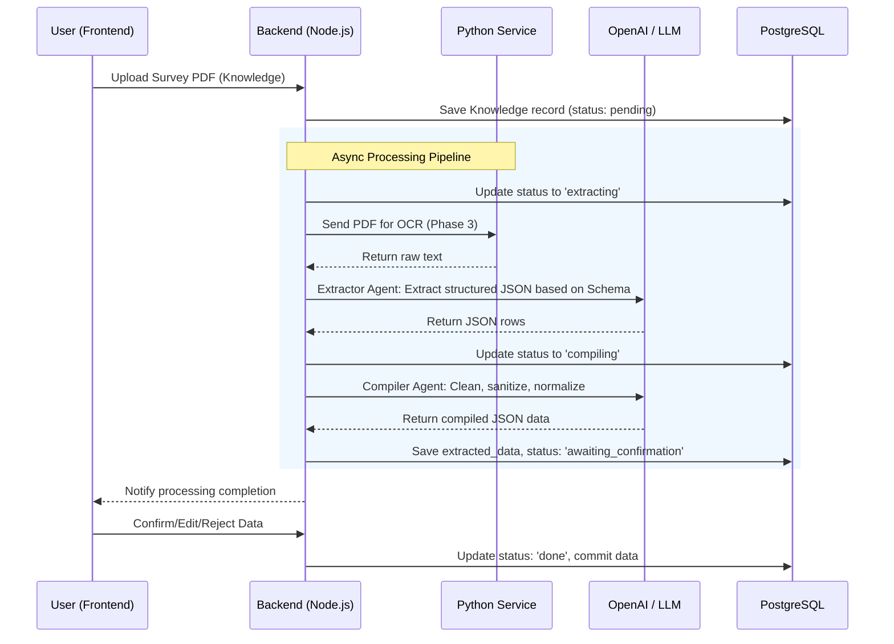
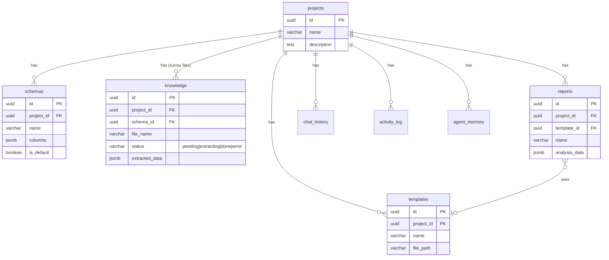

# Architecture Guidelines

## Project Overview
RisetBot is an automated government survey data processing platform powered by a multi-agent AI pipeline. It transforms raw PDF survey files into structured data, statistical analysis, and formal reports using a three-tier service architecture. Designed for Indonesian public-sector workflows, it combines document intelligence (OCR), agentic AI data extraction, and a chat interface to seamlessly query and compile survey results.

## Feature Apps
1. **Dashboard**: Global statistics, project overview, and activity tracking.
2. **Project Management**: Group surveys and schemas into logical project entities.
3. **Database & Schema Designer**: Define extraction columns and AI hints manually or auto-generate them using AI over sample text.
4. **Knowledge Base (Survey Uploads)**: Document ingestion, asynchronous OCR and extraction pipeline with Human-in-the-Loop confirmations.
5. **AI Analyst & Reporter**: Automated processing to generate statistical analysis, sentiment breakdown, thematic clusters, and exportable DOCX reports.
6. **ChatBot**: Project-scoped conversational interface to query processed survey data with transparency and source citations.
7. **Template Management**: Manage formal DOCX templates used as bases for final report generation.

## Tech Stack
RisetBot has been migrated to a standalone **3-service architecture**:

**1. Frontend (SPA)**
- **Framework**: React 18, Vite
- **Styling**: Tailwind CSS v4, Framer Motion
- **Data Fetching**: `@tanstack/react-query`, native `fetch` via centralized API service
- **Routing**: Wouter
- **Components**: Lucide React icons, local custom UI components

**2. Backend (Node.js API & Agent Orchestration)**
- **Runtime**: Node.js & TypeScript
- **Server**: Express.js
- **Database**: PostgreSQL (connected via raw `pg` queries)
- **Validation**: Zod
- **AI Integrations**: `openai` SDK, PraisonAI for multi-agent orchestration
- **Logging**: Pino & pino-http

**3. Python Service (AI/Data Processing)**
- **Framework**: FastAPI
- **OCR**: PaddleOCR, PyMuPDF
- **Data Analysis**: Pandas, NumPy
- **Reporting**: python-docx-template, Jinja2
- **RAG**: Reasoning-based document retrieval via LLM context-window

## Folder & File Project Structure

```text
risetbot/
├── backend/                  # Node.js API Service
│   ├── db/
│   │   └── schema.sql        # PostgreSQL raw tables definition
│   ├── src/
│   │   ├── agents/           # Refactored multi-agent modules
│   │   │   ├── supervisor.ts # Task routing & PraisonAI orchestration
│   │   │   ├── extractor.ts  # PDF OCR → LLM extraction pipeline
│   │   │   ├── compiler.ts   # Data cleaning & CSV/XLSX export
│   │   │   ├── analyst.ts    # Pandas-based analysis via Python svc
│   │   │   ├── reporter.ts   # DOCX report generation via Python svc
│   │   │   └── chatbot.ts    # RAG-powered Q&A via Python svc
│   │   ├── lib/              # Core business logic & db pooling
│   │   │   ├── activity.ts   # Activity logging
│   │   │   ├── agents.ts     # Base OpenAI agent implementations
│   │   │   ├── db.ts         # pg connection pool setup
│   │   │   ├── logger.ts     # Pino logger definition
│   │   │   ├── pythonService.ts # HTTP client for Python service
│   │   │   ├── retry.ts      # Exponential backoff retry utility
│   │   │   └── validators.ts # Zod API validations
│   │   ├── routes/           # Express Route Handlers
│   │   ├── app.ts            # Express App setup
│   │   └── index.ts          # Server entry point
│   ├── package.json          # Backend dependencies
│   └── tsconfig.json         # Backend TS Config
│
├── frontend/                 # React SPA Service
│   ├── src/
│   │   ├── components/       # Reusable UI elements
│   │   ├── pages/            # Application views/screens
│   │   ├── services/         # API abstraction (api.ts)
│   │   ├── App.tsx           # Router and main layout
│   │   └── main.tsx          # React application entry
│   ├── package.json          # Frontend dependencies
│   └── vite.config.ts        # Vite build configuration
│
├── python-service/           # FastAPI Data Service
│   ├── analysis/             # Pandas data analysis module
│   │   ├── data_analyzer.py  # Orchestration layer
│   │   ├── statistics.py     # Descriptive stats computation
│   │   └── sentiment.py      # Keyword + LLM sentiment analysis
│   ├── ocr/                  # PaddleOCR extraction module
│   │   ├── paddle_ocr_service.py # PaddleOCR wrapper
│   │   └── pdf_parser.py     # PyMuPDF + OCR fallback
│   ├── rag/                  # Reasoning-based RAG
│   │   └── pageindex_service.py # Vectorless context-window RAG
│   ├── report/               # DOCX template generation
│   │   └── docx_generator.py # Jinja2 template rendering
│   ├── utils/                # Helper functions
│   │   ├── data_compiler.py  # CSV/XLSX export via Pandas
│   │   └── file_handler.py   # File upload/validation/cleanup
│   ├── main.py               # FastAPI entry point with all routes
│   └── requirements.txt      # Python dependencies
│
├── docs/                     # Documentation & Tasks
│   ├── blueprint.md          # Original architecture vision
│   ├── specs.md              # Software Specification
│   └── task.md               # Development Task Tracking
│
└── .env                      # Unified environment variables
```

## Workflow



## Data Interaction



## Commands

**Backend:**
- `npm install` — Install Node dependencies
- `npm run dev` — Run development server using `tsx` (port 8000)

**Frontend:**
- `npm install` — Install React dependencies
- `npm run dev` — Run Vite dev server (port 3000)
- `npm run build` — Create production build

**Python Service:**
- `pip install -r requirements.txt` — Install dependencies
- `uvicorn main:app --reload --port 9000` — Run FastAPI server

## Code Style

### Components
- Use React Functional Components exclusively utilizing modern Hooks.
- Ensure components remain single-responsibility and stateless where possible UI logic is involved.
- Organize larger page sections into smaller, distinct components inside their respective feature folders.

### Imports
- Organize imports functionally:
  1. React/external libraries.
  2. Local services/utilities.
  3. Shared layout/UI components.
  4. Local components.
- Avoid relative paths spanning deeper than two levels (`../../`) — strive for flat directory structures inside features.
- In backend Node.js files (utilizing ESM), always append `.js` to local imports.

### Naming Conventions
- **Files**: `PascalCase.tsx` for React Components, `camelCase.ts` for utilities/libraries, `kebab-case.py` for Python logic.
- **Variables/Functions**: `camelCase` for normal functions and variables.
- **Interfaces/Types**: `PascalCase` describing the shape without the classic `I` prefix.
- **Database Tables**: `snake_case` (e.g., `agent_memory`, `chat_history`).

### Error Handling
- Use standard `try-catch` blocks for all async operations.
- Backend should log exact failures via Pino and return predictable standard JSON formats: `{ "error": "Clear description" }`.
- Frontend should catch errors locally, displaying friendly notification toasts while preserving the exact failure internally in console logs.

## UI Components
- **Tailwind CSS + Framer Motion**: All styling follows Utility-first principles. Advanced animations rely on Framer Motion.
- **Local SVGs / Icons**: Lucide-react used across the board.
- Avoid third-party overarching UI libraries where unnecessary. The system maintains bespoke minimal inputs, buttons, toggles designed strictly for a minimalist Apple-like UI layout.

## Accessibility
- All inputs have properly tied labels (`htmlFor`).
- Interactive elements possess appropriate `aria-labels` when text isn't explicitly visible.
- Semantic HTML tags (`header`, `nav`, `main`, `footer`, `section`, `article`) are utilized appropriately instead of relying solely on `div` wrappers.
- The platform supports forced distinct states (focus-rings on keyboard tab interactions).
